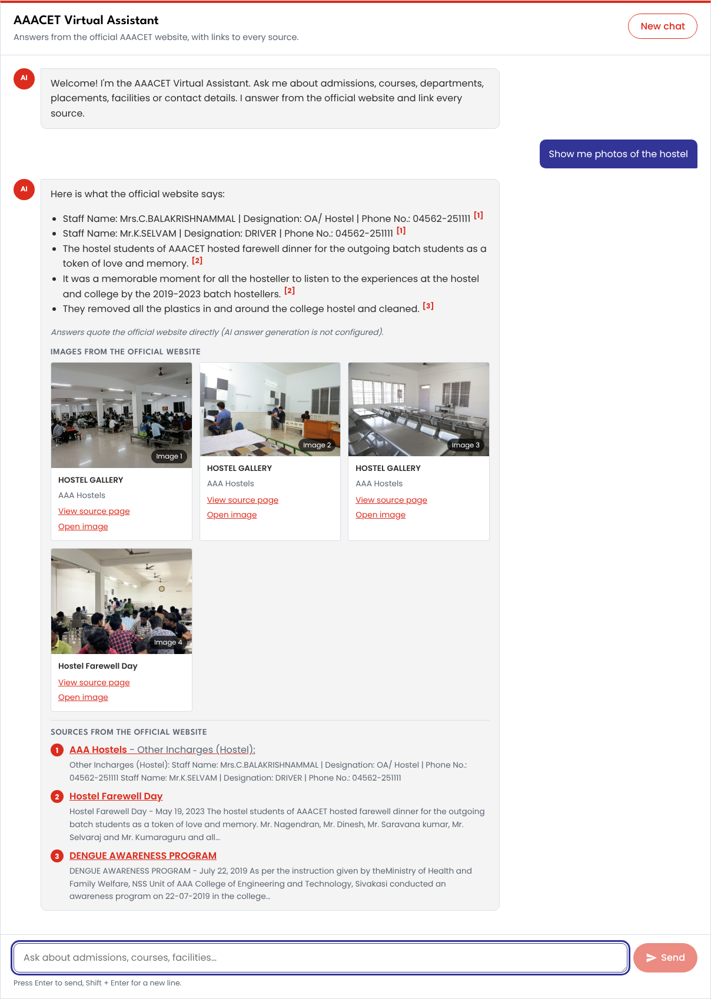
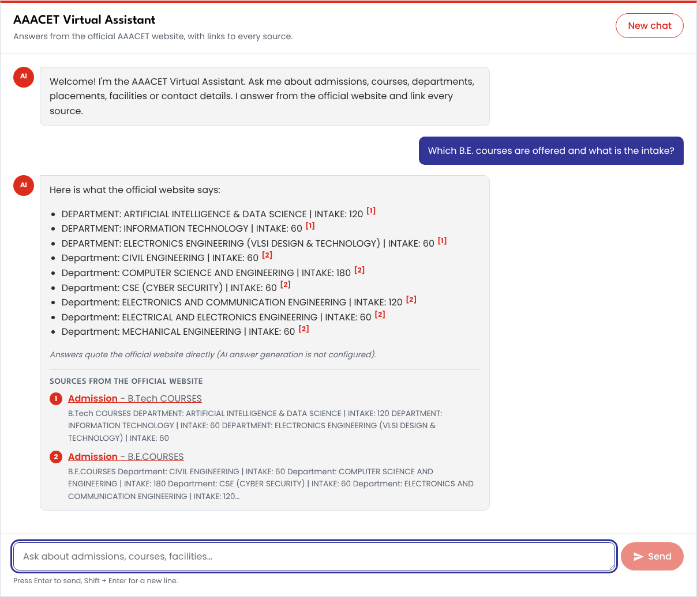
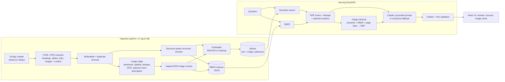
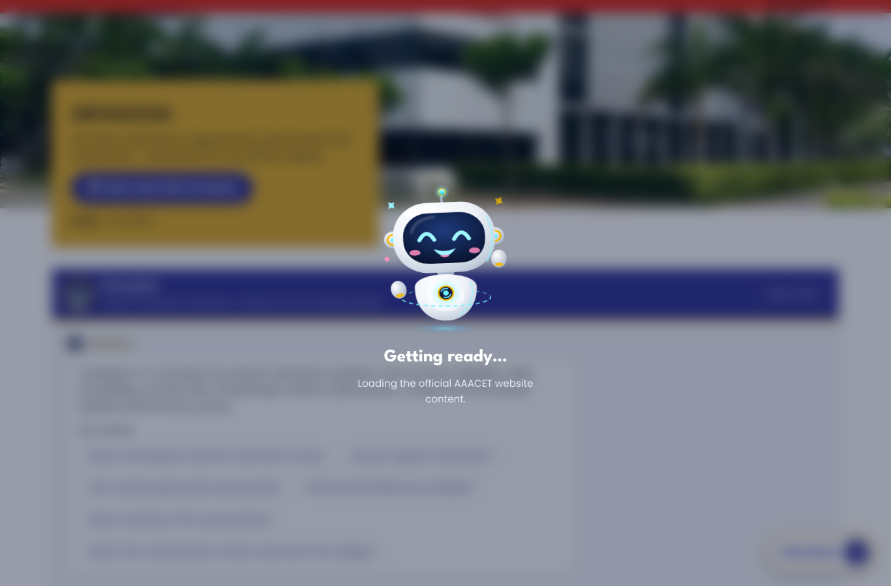
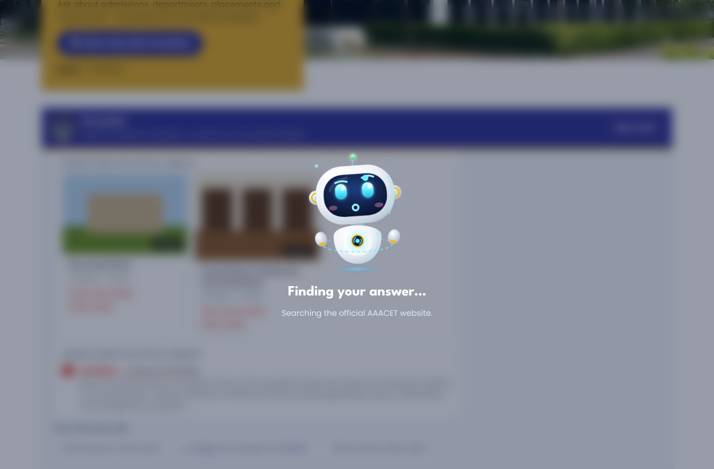
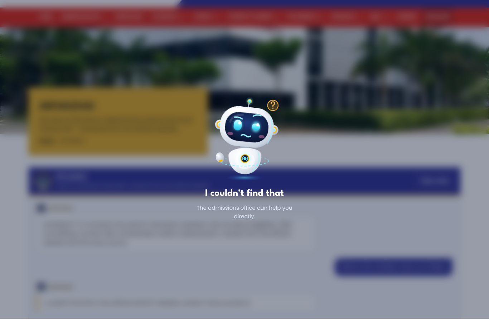
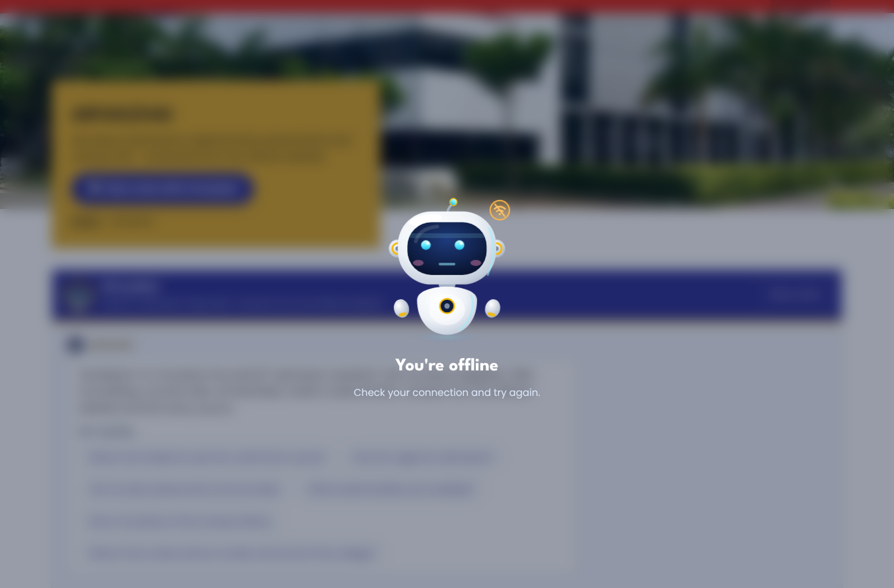

# Arivazhai: the AAACET admission assistant (multimodal RAG chatbot)

A retrieval-augmented chatbot for **AAA College of Engineering and Technology (AAACET)** that answers questions from the
official website [aaaenggcoll.ac.in](https://aaaenggcoll.ac.in/), cites every source page, and shows relevant college
images (photos, posters, notices) alongside the answer.

* **Text:** Structure-Aware Recursive Chunking
* **Images:** Caption/OCR-Based Image Chunking
* **Retrieval:** Hybrid Retrieval, which fuses semantic search (Qdrant) and BM25 with Reciprocal Rank Fusion (RRF)
* **Answers:** grounded generation with Claude, with citations validated server-side; an extractive no-LLM fallback
* **Stack:** Python, FastAPI, Scrapy, Qdrant, BM25, BAAI/bge-m3, Claude (text + vision), React + TypeScript + Vite

| Answer with real campus photos | Exact intake table from the admission page |
|---|---|
|  |  |

> Real answers from the shipped AAACET knowledge base in extractive mode (no API key). With `ANTHROPIC_API_KEY` set,
> Claude writes the answer from the same cited sources. The page layout, colours, fonts, logo, menu and footer were
> **measured from the official website** ([details](#matching-the-official-website)).

---

## Status

| Area | Status |
|---|---|
| **Knowledge base** | Crawled from https://aaaenggcoll.ac.in/ on 2026-10-18/19: **2,115 pages** (all 1,979 sitemap pages: main pages, department and lab pages, news posts, plus 69 PDFs) → 2,029 documents → **3,604 text chunks**; **4,785 images** (439 duplicates removed) with OCR text in 3,516. Shipped in `data/processed/`. |
| Retrieval quality on the real site | 35 labelled questions with the official pages that answer them (including every suggested question in the UI and a faculty-list question for each department), plus one off-topic question (`backend/eval/questions_aaacet.jsonl`): **Recall@1 = 0.71, Recall@3 = 0.97, Recall@5 = 0.97, MRR = 0.84**, image hit rate 1.0, with hybrid search and a semantic stand-in (all-MiniLM-L6-v2, the only model the build environment could download). Before the section-level chunking it was 0.77 / 0.97 / 0.97 / 0.87: two questions now get a matching section of another page first (the home page's "Hostel Facilities" box, a department's "Journal Editorial Board Member" list), while the answers themselves got much better (see the next row). Asked for a department's faculty, the extractive answer lists every name for all 10 departments, the main faculty list first (for CSE, EEE and Civil the visiting professors page is the top search hit, the faculty list second). Misses: "What courses does AAACET offer?" ("offer" matches a job-offer post) |
| Complete answers (no API key) | 60 questions written from the live website by someone who never saw this system, each with every fact a complete answer contains (2–6 per question, 245 facts; `backend/eval/facts_aaacet.jsonl`, `python -m rag.cli eval-facts --verbose`). Each fact is traced to where it is lost. Before: answers held **40%** of their facts; 32% were handed to the answer composer and left out, 22% were found but ranked below the results used, 6% were not in the knowledge base. After the fixes below: **74%** on the 40 questions used while fixing (was 44%; 21 complete answers, was 9) and **47%** on the 20 held-out questions never looked at (was 31%). What is left is mostly ranking (28% of held-out facts are found but ranked too low) and about 4% of facts that are only in scanned PDFs, images or a brochure the crawl never reached. |
| Answer quality (no API key) | 40 everyday questions, each with the fact a correct answer must contain (`backend/eval/answers_aaacet.jsonl`, `python -m rag.cli eval-answers`): **40/40** (was 18/40 before the tab, chunking and answer fixes below). 20 held-out questions written after tuning and never tuned on (`answers_aaacet_holdout.jsonl`): **19/20** (was 16/20). Measured with hybrid search (all-MiniLM-L6-v2 stand-in) in extractive mode. Page retrieval after these changes: Recall@1 0.71, Recall@3 0.97, MRR 0.84. |
| Official branding | Measured from the rendered site: red `#db2c1d` menu and buttons, white→indigo `#323496` header, gold `#e0ac2a` title box, `#151414` footer, Poppins / League Spartan, official logo, banner photo, full menu with dropdowns, contact details |
| Tests | 110 backend tests, 28 frontend unit tests, 22 Playwright tests on desktop, tablet and mobile |
| Embeddings | `bge-m3` (BGE-M3 via PyTorch, `requirements-ml.txt`) → falls back to **FastEmbed BGE-small** (`BAAI/bge-small-en-v1.5`, ONNX, installed by default, downloads ~70 MB on first start; `FASTEMBED_MODEL` selects another FastEmbed model) → falls back to an offline hashing embedder. The build environment could not download BGE weights; the hybrid numbers above use all-MiniLM-L6-v2 as a stand-in (a model of the same size class), so BGE-small itself is unmeasured. |
| Claude answers / vision descriptions | Implemented and unit-tested with a mocked client. Needs `ANTHROPIC_API_KEY`. Without a key the app answers in extractive mode (it quotes the most relevant sentences and tables). |
| Off-topic questions | With Claude, the model replies "not covered" via a `[[NO_ANSWER]]` marker. In extractive mode, an off-topic question that shares a word with some page may still get loosely related quotes. |
| Docker images / Compose | Written, but not built in the build environment (no Docker daemon). |

---

## Architecture



### Text: Structure-Aware Recursive Chunking (`backend/rag/chunking/text_chunker.py`)
1. Each page is parsed in document order into heading / text / table blocks, with a heading stack. Every block records
   its heading path (`Page title > H1 > H2 > …`). Menus built from link cards (a list whose items are only a link
   around a heading, like each department's sub-page menu) are navigation, not headings, so a department's faculty
   table sits under "Artificial Intelligence and Data Science" rather than under the menu's last entry.
   A page's first heading followed directly by other headings (a department banner over its menu) stays the parent
   of everything below, even under same-level headings such as Civil's `<h2>ACADEMIC YEAR 2025 – 2026</h2>`.
   Table header rows written with `<td>` cells are recognised even with long labels, so every row reads
   `Name of the Faculty: Dr.M.Karuppasamy | Highest Degree: Ph.D. | …`.
   **Tab panels and accordions** (89 of the site's pages, e.g. the admission page's "Courses offered", "Management
   Quota", "TNEA B.E./B.Tech. Eligibility" tabs) are sections of their own, titled with their tab's name: one tab's
   headings never become the parents of the next tab's content.
   Accordion titles are kept although Elementor wraps them in a `…-title-header` class (it removed every bus route's
   name). Cards drawn as a run of headings with nothing under them (a department's labs, the college's mission
   points) become a bullet list of their section instead of being dropped as empty.
2. Blocks are grouped into sections by heading. **Every real section is its own chunk**, so a chunk is about one topic:
   only a short subsection joins its section, and one-line sections share a chunk with each other. (Merging every
   sibling section up to the chunk size mixed the admission page's tabs into one chunk, and answers quoted the wrong
   one.)
3. Oversized sections are split recursively: paragraphs/tables, then sentences, then words. The sentence splitter
   knows Indian academic abbreviations (B.E., Ph.D., Rs., Dr., …).
4. Tables are split only on row boundaries, and every piece repeats the header, so a row such as
   `Programme: B.Tech | Fee: Rs. 60,000` is never cut.
5. Consecutive pieces overlap by whole sentences (default 100 tokens; chunks default to 650 tokens, both configurable).
6. Each chunk stores its ID, text, page title, heading path, source URL, document ID, content hash, token count and
   duplicate URLs. Identical chunks found on several pages are stored once.

### Images: Caption/OCR-Based Image Chunking (`backend/rag/images/`)
* The extractor collects `` tags (including lazy `data-src` and the largest `srcset` candidate), figure captions
  and CSS background banners. For each it records alt text, title, filename, nearest heading path, and the text before
  and after the image.
* Downloads are restricted to the allowed hosts and capped in size. Each file is verified with Pillow and stored under
  its SHA-256 (remote filenames are never used as paths). Exact duplicates are caught by SHA-256 and resized copies by
  a perceptual hash. Logos/icons repeated on most pages are marked `boilerplate`. Tiny images, broken links and invalid
  files each get a recorded status.
* OCR (RapidOCR, ONNX models bundled, works offline; Tesseract optional) reads posters, notices and banners.
* With `VISION_ENABLED=true`, a vision-capable Claude model writes a short factual description. The prompt forbids
  naming people or guessing facts that aren't visible.
* One chunk per image, with every field labelled by provenance: `Alt text`, `Caption`, `Text in image (OCR)`,
  `Nearby text`, `AI-generated description`. Keywords come from extracted fields only.

### Hybrid retrieval (`backend/rag/retrieval/hybrid.py`)
* **Query:** request words are dropped ("show me photos of") and department short forms are spelled out the way the
  website names them (`QUERY_EXPANSIONS`: "AI&DS" → "Artificial Intelligence and Data Science", CSE, ECE, EEE, MECH, IT,
  S&H, HOD). They are replaced, not appended: event posts repeat "III AI&DS" in class names, department pages don't.
* **Text:** Qdrant cosine top-30, BM25 top-30 and a BM25 ranking over page titles, URL path words and section headings
  (so "Faculty List" under "/ai-dept/" or "Principal Message" pages are found by their title; weight
  `TITLE_RANK_WEIGHT=6`, scaled by the square of the share of the question the title covers, so a title sharing one
  word with the question barely counts; chosen on the eval set in both keyword-only and hybrid mode) are fused with RRF (`k=60`)
  together with a query-coverage ranking, a ranking by the question's exact two-word phrases ("counselling code",
  "required documents"; only phrases found in few candidates count), and `Label: value` facts whose label the
  question names ("COUNSELLING CODE : 4680", "Address: …", the `INTAKE: 120` cells of the courses table;
  `LABEL_RANK_WEIGHT=3`). Chunks with the question's two rarest words are added as candidates, so "intake for AI&DS"
  finds the one table with "intake" among a hundred AI&DS pages. The query drops filler ("available"), drops
  "department" when a department is named and the question asks about something in it ("faculty of the Civil
  department"), and adds the website's word for an intent (`QUERY_SYNONYMS`: "where / located" → "address",
  "seats" → "intake"). A table section that matches is completed in page order (`SECTION_EXPAND_MAX=10` chunks),
  so a faculty table split over several chunks reaches the answer whole; prose sections are not, so a long page
  never pushes the answering chunk out of the top sources. Exact-duplicate chunks are dropped and an
  optional cross-encoder reranker can reorder the results. A semantic-only hit below `TEXT_MIN_SEMANTIC_SCORE` cannot
  enter the results on its own, so off-topic questions return "no answer" instead of noise.
* **Images:** three ranked lists (semantic over image chunks, BM25 over image chunks, and images located on the
  retrieved text pages) are fused with RRF. An image is shown only if it matched the question lexically or
  semantically; appearing on a relevant page is never enough by itself. Images are retrieved through their text
  evidence, because the configured embedders are text models. Direct pixel-vector search would need a genuinely
  multimodal embedding model.

### Grounded answers (`backend/rag/llm/`)
* Claude receives only the retrieved evidence, as `<source id="S1">` and `<image id="I1">` blocks. OCR text and
  AI-generated descriptions are labelled differently in the prompt and in the UI.
* The system prompt requires a citation for every fact and a `[[NO_ANSWER]]` marker when the evidence does not cover
  the question. It also tells Claude to ignore instructions embedded in page content.
* Server-side, citations to non-existent sources are removed and the rest renumbered. **Any URL the model writes that
  is not one of the retrieved official URLs is stripped.** Only cited sources are returned.
* Defaults: `claude-opus-5-5`, effort `low` (fast chat answers), and refusal fallbacks enabled (`fallbacks: "default"`).
  All are configurable in `.env`.
* Answers are written to be easy to read: a direct answer first, plain words, only what answers the question, and a
  small table (3-5 columns) for lists.
* **Any language:** a question that is not in English (Tamil, Hindi, Arabic, French..., also Tamil typed in Latin
  letters) is translated by Claude into an English search query (the website is in English) and answered in the
  question's language, with names, numbers and citations unchanged (`backend/rag/llm/language.py`, `TRANSLATE_PROMPT`).
  This needs `ANTHROPIC_API_KEY`; without it, answers stay English quotes and the UI says so. An answer in another
  language has a **Show in English** button (`POST /api/translate`, `ANSWER_TRANSLATE_PROMPT`) that switches between
  the English version and the original; links stay limited to the ones the answer already had.
* **Follow-up questions:** the earlier turns go to Claude with the new question, and with a key a follow-up is first
  rewritten into a standalone search ("its fees" names the course; `CONTEXT_PROMPT`). Without a key, follow-ups are
  resolved by rule: "what about its labs?" after a CSE question searches the CSE labs, "and civil?" or "what about
  ECE?" repeats the earlier question for that department, and department words alone ("HOD?", "labs?") stay on the
  department being discussed.
* **Next questions:** every answer comes with three full questions to ask next (`follow_ups`): about the same
  department, then related topics (fees → scholarships, hostel → transport…), never one already asked. They are shown
  under the latest answer.
* **Finding the chat:** a bouncing "Chat below" down arrow at the bottom-right while the question box is still below
  the screen (and the Arivazhai menu link) scroll to the chat and put the cursor in the question box, with no robot moment; the arrow
  hides once the chat is in view.
* **Contact details:** when the website does not cover a question, and for questions about contacting the college,
  the answer ends with the office's phone numbers (04562-251111, 04562-251112, toll-free 1800 425 8807, tap to call)
  and emails (enquiry@, admissions@). For admission, scholarship and fee questions, and when the website has no answer,
  the card also lists the admission & scholarship staff from the admission page. These come from
  `frontend/src/brand/contacts.json` (kept by hand, with sources) merged with the footer's contacts in `brand.json`.
* **Answer model:** Claude (`ANTHROPIC_API_KEY`) or Google Gemini (`GEMINI_API_KEY`, free tier for the Flash models).
  With `LLM_PROVIDER=auto` (the default) a Claude key wins, then a Gemini key; one Gemini key in `.env` is enough
  to switch. Both get the same grounded prompt, citations, translations and follow-up questions; a Gemini answer
  stopped for repeating its sources word for word ("recitation") falls back to quoting the website.
* Questions about the college's strengths ("Why should I choose this college?", "what is special about AAACET")
  search for its "About College" sections (youngest NAAC 'A' college, ISO 21001, research centre, 400+ papers).
* If no key is configured, or the LLM API fails, the answer falls back to quoting the website (extractive mode), and
  the UI shows a notice. **The best sections are quoted whole, in search order**: the first one at length (24 lines, a
  table up to 40 rows), up to two more shorter, and only while they share most of the question's weight with the
  first, so "what documents should I bring" lists every certificate instead of one matching line. When the best
  results are subsections of one section (each bus route of the transport page), that section's own overview goes
  first. `EXTRACTIVE_WHOLE_SECTIONS=false` restores the older composer described next: a short section whose title names the question ("TNEA B.E./B.Tech. Eligibility", "Fees",
  "Required Documents") is quoted whole, with its sub-headings as labels ("**Tuition Fee:** …"), so the line with the
  answer is never dropped; equally named sections of one page are all quoted ("Eligibility" gives B.E., M.E. and
  Ph.D.). Extractive answers are formatted too: a table answer becomes one compact Markdown table
  ("**Faculty List – Artificial Intelligence and Data Science** · 13 entries") with the useful columns (serial numbers,
  mostly empty and long official columns dropped, columns named in the question kept). Tables that match about as well
  are shown too, the one whose page title names the question first, then the bigger (a department's faculty list
  before its visiting professors; B.E. and B.Tech intake), and text answers are short bullet lists grouped by page, keeping only
  sentences that score at least half as well as the best one.

### Suggestions while typing (`backend/rag/retrieval/suggest.py`, `GET /api/suggest?q=`)
* Candidates: common questions, four questions for each department in `DEPARTMENTS` (faculty, about, labs, vision and
  mission), and "Tell me about …" for each section page of the website (titles used by one page only).
* Every word typed must start a word of the suggestion, and department short forms are spelled out first, so
  "ai&ds fac" suggests "Who are the faculty of the Artificial Intelligence and Data Science department?".
* The input is an accessible combobox: ↑/↓ to pick, Enter or click to ask, Tab to copy into the box, Esc to close.

### Arivazhai's moments (`frontend/src/robot/`)
The chat is the **Admission Help Desk** from the design project (navy header with a gold rule, "Arivazhai" message
labels, quick topics above the question box) in the official website's colours and fonts. Its robot, **Arivazhai**,
never sits in the chat: it pops up centred over a blurred screen for about 3 seconds (0.35 s in, 2.2 s hold, 0.4 s
out, from the design) and then floats away. The overlay never blocks the page: typing and clicks go through, and Esc
dismisses it early. The rig and its CSS are copied unchanged from the design's `Moments.dc.html`.

| Moment | When |
|---|---|
| Loading ("Getting ready…", the robot already hops and waves) | page opened, while the assistant is contacted (`/api/health`) |
| Welcome ("Vanakkam! I'm Arivazhai") | the assistant answered the first contact; the same wave continues |
| Thinking ("Finding your answer…") | a question is sent |
| No data ("I couldn't find that") | the answer is not on the official website |
| Error ("Something went wrong", "Can't reach the assistant", …) | server, timeout, rate-limit or connection failure |
| No network ("You're offline") | the device is offline |

| Loading | Thinking | No data | No network |
|---|---|---|---|
|  |  |  |  |

---

## Project structure

```
backend/
  rag/
    crawler/        Scrapy spider + runner (robots.txt, delays, PDFs)
    extraction/     HTML/PDF → structured blocks; boilerplate & duplicate page removal
    chunking/       structure-aware recursive chunker, token counting
    images/         downloader/validation, OCR, vision descriptions, image chunks
    embeddings/     BGE-M3 and hashing embedders
    index/          Qdrant store, BM25 index, incremental indexer + validation
    retrieval/      RRF, hybrid text + image retrieval
    llm/            prompts, Claude client, extractive fallback, answer service
    api/            FastAPI app, rate limiting, admin auth, services/reindex jobs
    eval/           Recall@K / MRR evaluation
    demo/           fictional demo website generator (tests + offline demo)
    cli.py          command-line entry point
  eval/             labelled question sets (demo + AAACET samples)
  tests/            pytest suite
frontend/
  src/components/   Header, ChatWindow, MessageBubble, ChatInput, SuggestedQuestions,
                    SourceList, ImageCard, LoadingIndicator, ErrorMessage, Footer
  src/robot/        Arivazhai's moments: the design's robot rig, moment timing and the overlay
  src/brand/        brand.json + brand.css (measured from the official site by scripts/measure_brand.mjs)
  public/brand/     official logo, banner photo and favicon downloaded by the same script
  src/__tests__/    Vitest + Testing Library tests
  e2e/              Playwright tests (desktop / tablet / mobile) + screenshots
data/processed/     the AAACET knowledge base snapshot (chunks + image metadata) shipped with the repo
scripts/
  measure_brand.mjs measure colours, fonts, logo, menu, contacts from the rendered official site
  extract_brand.py  fallback: parse stylesheets / a saved page without a browser
  e2e_backend.sh    API on the demo dataset for UI tests
docs/screenshots/   generated by the e2e tests
```

---

## Setup

Requirements: Python 3.11+ and Node 20+. Optional: Docker (for a Qdrant server) and a GPU for BGE-M3.

```bash
cp .env.example .env            # then fill in ANTHROPIC_API_KEY and ADMIN_TOKEN
make install                    # venv + backend deps + frontend deps
make install-ml                 # BGE-M3 (PyTorch, sentence-transformers); skip for the offline demo
cp frontend/.env.example frontend/.env
```

### 1. Try it offline in two minutes (fictional demo data)
```bash
make demo                                   # builds, serves, crawls and indexes the FICTIONAL demo site into data/
EMBEDDING_PROVIDER=hashing make serve       # API on http://127.0.0.1:8000
make dev                                    # UI on http://localhost:5173
```

### 2. Use the real AAACET knowledge base (shipped in the repo)
The repository includes the processed content of the official website in `data/processed/` (text chunks and image
metadata, crawled from https://aaaenggcoll.ac.in/). On the first start the API builds the Qdrant and BM25 indexes from it
automatically, so you only need to start the two servers. The keyword (BM25) index is ready within seconds and the
assistant answers with it straight away; the semantic vectors (3,388 text and 4,785 image chunks) are embedded in the
background, which can take a long time on a laptop CPU, and the API switches to hybrid search when they are done. The
backend terminal logs `Indexing aaacet_text: 1152/3388 (34%)`-style progress, `/api/health` reports
`"status": "indexing"` meanwhile, and an interrupted build resumes where it stopped on the next start:
```bash
make serve        # API on http://127.0.0.1:8000  (first start: "Building the search index ...")
make dev          # UI on http://localhost:5173
```
Image cards load the photos from the official website. The downloaded copies are not committed; run the image stage
locally if you want local copies.

### 3. Refresh the knowledge base from the live website
```bash
make all          # crawl → extract → images/OCR → chunk → index  (python -m rag.cli all)
```
The crawler reads `robots.txt`, seeds itself from the WordPress sitemaps (all pages, department pages, labs and news
posts), skips archive listings, and keeps a polite rate of about one request per second, so a full crawl takes 45 to
60 minutes. Individual stages: `python -m rag.cli crawl | extract | images | chunk | index [--full] | status` (run
from `backend/`). Indexing is **incremental** by default: only changed pages are re-embedded and removed pages are
deleted. Changing the embedding model or dimension automatically triggers a full rebuild, so vectors from different
models are never mixed.

Evaluate retrieval against labelled questions with the official source pages that answer them
(`backend/eval/questions_aaacet.jsonl`):
```bash
make eval          # Recall@1/3/5, Hit@K, MRR, image hit rate, unanswerable rejection
```

### Matching the official website
The frontend reads every colour, font, the logo, the banner photo, the menu (with its dropdowns), the header buttons,
footer links and contact details from `frontend/src/brand/` and `frontend/public/brand/`. These were **measured from
the rendered official site** and are committed. To re-measure after the website changes:
```bash
make brand        # = cd frontend && node ../scripts/measure_brand.mjs --inner /aaa-hostels/
```
The script opens the live site in headless Chromium and reads the *computed* styles of the real header (white→indigo
diagonal), menu bar, buttons, page-banner title box and footer, plus the fonts (Poppins, League Spartan). It downloads
the official header logo, a banner photo and the favicon, and extracts the menu, header buttons, footer link columns,
social links and contact details. Text colours that fail WCAG AA contrast are adjusted, and every adjustment is
reported. For example, the site's white-on-gold banner title (2.1:1) is rendered dark-on-gold (8.9:1). Anything it
cannot find keeps its previous value. `scripts/extract_brand.py` is a browser-free fallback that parses stylesheets or
a saved page. Confirm with the college that using the official logo on the assistant is permitted.

The chat is offered two ways:
* **as a page** that reproduces the site's header, menu, page banner/breadcrumb and footer, at `/`
* **as an embeddable panel** at `/?embed=1`, for example
  `<iframe src="https://assistant.example/?embed=1" title="Arivazhai" style="width:100%;height:640px;border:0"></iframe>`.
  `frontend/nginx.conf` already allows framing by `aaaenggcoll.ac.in`.

---

## API

| Method | Path | Purpose |
|---|---|---|
| POST | `/api/chat` | grounded answer + cited sources + images |
| POST | `/api/translate` | English version of an answer in another language (needs `ANTHROPIC_API_KEY`) |
| GET | `/api/suggest?q=` | type-ahead question suggestions |
| POST | `/api/search/text` | hybrid text retrieval (with semantic/BM25 ranks) |
| POST | `/api/search/images` | image retrieval |
| GET | `/api/sources/{chunk_id}` | full chunk text and metadata |
| GET | `/api/images/{image_id}` / `/file` | image metadata / the downloaded file |
| GET | `/api/health` | readiness, embedder, LLM, Qdrant point counts |
| GET | `/api/status` | crawl / extract / images / chunk / index status |
| POST | `/api/admin/reindex` | start a background reindex (Bearer `ADMIN_TOKEN`) |
| GET | `/api/admin/jobs/{id}` | reindex job status (Bearer `ADMIN_TOKEN`) |

```bash
curl -s localhost:8000/api/chat -H 'Content-Type: application/json' \
  -d '{"message": "What is the admission procedure?", "history": []}' | jq
curl -s localhost:8000/api/search/images -H 'Content-Type: application/json' -d '{"query": "hostel", "top_k": 3}' | jq
curl -s -X POST localhost:8000/api/admin/reindex -H "Authorization: Bearer $ADMIN_TOKEN" \
  -H 'Content-Type: application/json' -d '{"recrawl": true, "full": false}'
```

Example `/api/chat` response (abridged):
```json
{
  "answer": "Admission is through TNEA counselling [S1] …",
  "mode": "llm",
  "insufficient_evidence": false,
  "sources": [{"id": "S1", "title": "Admission", "url": "https://aaaenggcoll.ac.in/…", "heading": "…", "snippet": "…"}],
  "images": [{"id": "I1", "src": "/api/images/ab12…/file", "original_url": "…", "source_page": "…",
              "alt": "…", "caption": "…", "ocr_text": "…", "description": "", "description_is_ai_generated": false}],
  "related_sources": [], "notice": "", "model": "claude-opus-5-5"
}
```
`mode` is `llm`, `extractive` (no key, or the LLM was unavailable; `notice` explains which) or `no_answer`.

---

## Testing

```bash
make test-backend     # pytest: crawler (real Scrapy run against a local site), extraction, chunking, OCR,
                      # image validation/dedupe, embeddings, Qdrant, BM25, RRF, incremental indexing,
                      # hybrid retrieval, citations, answer generation, Claude client, API, brand extractor,
                      # Recall@K / MRR thresholds
make test-frontend    # tsc + Vitest: chat submission, Enter/Shift+Enter, loading, sources, image cards,
                      # broken-image fallback, no-answer, network error + retry, new chat, embed mode
python -m rag.cli eval-answers   # answer quality: does each answer contain the fact a student needs?
python -m rag.cli eval-facts --verbose   # complete answers: which facts each answer misses, and where they are lost
make e2e              # Playwright against the real API (demo data): desktop 1366px, tablet 820px,
                      # mobile 390px; checks no horizontal scrolling, real image loading, keyboard use,
                      # mobile menu; writes docs/screenshots/*
```
`make e2e` uses `PLAYWRIGHT_CHROMIUM_PATH` when set (pre-installed Chromium); otherwise run `npx playwright install chromium` first.

---

## Configuration and credentials

All configuration lives in environment variables (see `.env.example`). The external credentials are:

| Variable | Needed for | Without it |
|---|---|---|
| `ANTHROPIC_API_KEY` | Claude answers, vision descriptions | extractive answers, no AI image descriptions |
| `GEMINI_API_KEY` | Gemini answers (`LLM_PROVIDER=auto` or `gemini`; `GEMINI_MODEL`, default `gemini-flash-latest`, the Flash models are on Google's free tier). Used when no Anthropic key is set | extractive answers |
| `ADMIN_TOKEN` | `/api/admin/*` | admin endpoints return 503 |
| `QDRANT_API_KEY` | secured Qdrant server / cloud | not needed for local or embedded Qdrant |
| Hugging Face access | first download of `BAAI/bge-m3` | set `EMBEDDING_MODEL` to a local path, or use `hashing` |

---

## Security notes
* Secrets come only from the environment. `.env` is git-ignored and no key appears in source.
* Inputs are validated: message length (`MAX_QUESTION_CHARS`), history size and roles, request body size (64 KB), and
  per-IP rate limiting (`RATE_LIMIT_PER_MINUTE`, in-memory; use a shared limiter behind several workers).
* Admin endpoints use a constant-time Bearer token check and are disabled when no token is set. Only one reindex job
  can run at a time.
* Files: images are stored under content hashes and served only by ID, with traversal-safe path resolution, the stored
  MIME type, and `nosniff`. Image size and pixel count are capped (decompression-bomb guard). BM25 indexes are JSON,
  never pickle.
* Output safety: model-written URLs not in the retrieved set are removed. The UI renders Markdown without raw HTML,
  renders only `http(s)` links, and opens external links with `rel="noopener noreferrer"`. Page text is treated as
  data, not instructions.
* Crawling obeys `robots.txt`, stays on the allowed domains, and uses AutoThrottle with a polite delay and a descriptive
  User-Agent.
* CORS is limited to `CORS_ORIGINS`.

## Deployment
```bash
cp .env.example .env    # set ANTHROPIC_API_KEY, ADMIN_TOKEN
docker compose up -d --build
docker compose run --rm backend python -m rag.cli all      # first crawl + index
# UI: http://localhost:8080   (nginx proxies /api to the backend; Qdrant runs as a server)
```
Schedule refreshes with cron (`docker compose run --rm backend python -m rag.cli all`, incremental) or call
`POST /api/admin/reindex`. Put the frontend behind HTTPS on the college's domain and point `CORS_ORIGINS` at it.
Embedded Qdrant (`QDRANT_URL` empty) is for single-process development. Use the Qdrant server in production.

### Qdrant Cloud
1. Create a cluster at https://cloud.qdrant.io and an API key for it.
2. In `.env`: `QDRANT_URL=https://<cluster-id>.<region>.cloud.qdrant.io:6333` and `QDRANT_API_KEY=<key>`.
3. `cd backend && python -m rag.cli check-qdrant` checks each step (`.env`, URL, key, connection, vectors uploaded)
   and prints the next one.
4. Fill it once (stop the API first): `python -m rag.cli index`, then start the API as usual. A failed upload
   continues where it stopped; an API started on a cluster with missing vectors uploads them itself, answering with
   keyword search meanwhile.

Only the vectors move: the keyword index, the knowledge base and the index manifest stay in `DATA_DIR`. Switching
`QDRANT_URL` back to a local folder built earlier needs `index --full`, because the manifest describes the last store
built.

### Backend on Hugging Face Spaces, frontend on Netlify
Netlify serves static sites only, so the backend runs on a Hugging Face Space (Docker, free CPU tier with 16 GB RAM)
and uses the vectors already in Qdrant Cloud.

1. Vectors in Qdrant Cloud (above). `index` also stores the record of what is indexed in the cluster
   (`aaacet_text_meta`): a server without `data/index` restores it at start instead of embedding and uploading
   everything again. `check-qdrant` reports it (`upload record stored in the cluster`).
2. A Hugging Face access token with write permission (https://huggingface.co/settings/tokens), then:
   ```bash
   python scripts/deploy_hf_space.py --space <hf-username>/arivazhai-api --cors https://<site>.netlify.app
   ```
   It checks the cluster, creates the Space, stores `QDRANT_URL`, `QDRANT_API_KEY` (and `ANTHROPIC_API_KEY` if set)
   as Space secrets and `CORS_ORIGINS` as a variable, and uploads `deploy/huggingface/` (Dockerfile on port 7860,
   the search model built into the image), `backend/rag` and the knowledge base. `--dry-run` lists the files.
   The API is at `https://<hf-username>-arivazhai-api.hf.space` (`/api/health`). A free Space sleeps after 48 hours
   without visitors and wakes on the next request (about a minute).
3. Netlify: import the GitHub repository; `netlify.toml` sets the base directory (`frontend`), build command and
   headers. Set `VITE_API_BASE_URL` to the Space's address under Site configuration → Environment variables, and
   redeploy. If the Netlify address changes, run the script again with the new `--cors`.

Tested here by building the Space image from exactly the uploaded files and starting it against a Qdrant server
holding the vectors: ready in about 12 seconds, the record restored, nothing re-uploaded, hybrid search, CORS allowing
the Netlify origin. (This build environment's proxy blocks Debian's package server and model downloads, so the test
image skipped the `apt-get` and model steps that run normally on Hugging Face.)

## Troubleshooting
| Symptom | Fix |
|---|---|
| `/api/health` says `degraded` / chat returns 503 | Run the pipeline first (`make all` or `make demo`), or read the `error` field (e.g. BGE-M3 not installed) |
| `Storage folder … is already accessed by another instance` | Embedded Qdrant allows one process: stop the API before running CLI indexing, use `/api/admin/reindex`, or set `QDRANT_URL` to a server |
| `The write operation timed out` while indexing into Qdrant Cloud | Slow upload: update and run `python -m rag.cli index` (no `--full`) to resume; uploads are 16 points with a 120 s limit and a batch that keeps timing out is sent in halves. Still timing out: `QDRANT_UPSERT_BATCH=4` in `.env` |
| `401 (Unauthorized)` / `Invalid API key or JWT` | `QDRANT_API_KEY` in `.env` does not match the Qdrant Cloud cluster's key |
| `Collection … has N-d vectors but the embedder produces M-d` | You changed the embedding model: `python -m rag.cli index --full` |
| Crawl finishes with 0 pages | Check network access to the site, `CRAWL_ALLOWED_DOMAINS`, and `robots.txt` (`python -m rag.cli status` shows `robots_forbidden`) |
| Answers say "AI answer generation is not configured" | Set `ANTHROPIC_API_KEY` (or log in with `ant auth login`) and restart |
| OCR text empty | `OCR_ENGINE=rapidocr` needs `libgl1`/`libglib2.0-0` on slim Linux images; check `/api/status` → `images.ocr_engine` |
| Images missing in the UI | They fall back to the original URL, then to a placeholder; check `data/processed/images.jsonl` statuses (`http_error`, `too_large`, …) |
| Frontend can't reach the API | `npm run dev` forwards `/api` to `http://127.0.0.1:8000` when `VITE_API_BASE_URL` is empty (set `VITE_DEV_API_PROXY` for another port). If you set `VITE_API_BASE_URL` in `frontend/.env`, `CORS_ORIGINS` in `.env` must include the frontend's address |
